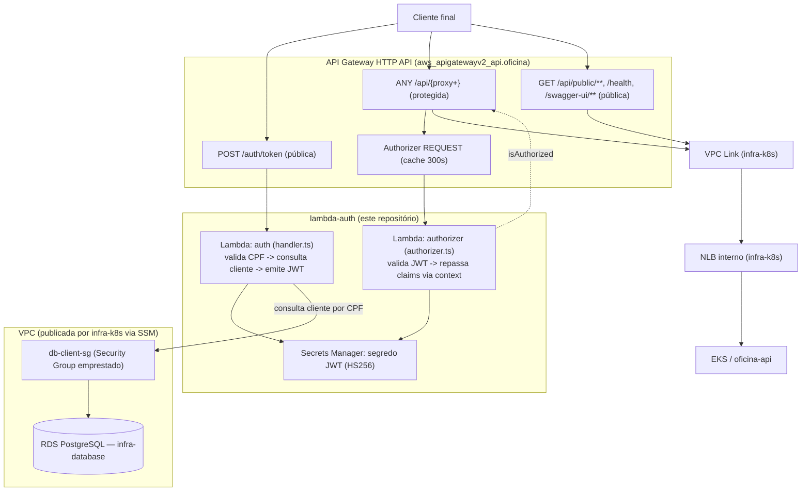

# lambda-auth — Autenticação serverless por CPF

Terceiro dos quatro repositórios da Fase 3 do Tech Challenge FIAP PosTech
(SOAT). Function **AWS Lambda** que autentica o cliente final da oficina
pelo CPF (sem senha) e emite o JWT consumido pelas rotas protegidas do
**API Gateway**; inclui também o **Lambda Authorizer** que valida esse JWT
nas demais requisições, e o Terraform que provisiona ambos, o próprio API
Gateway e o VPC Link até o cluster.

## Propósito

A especificação da Fase 3 exige uma function serverless que "valide o CPF,
consulte a existência do cliente e devolva um JWT" para as rotas sensíveis
da API. Este repositório é o dono desse fluxo: não guarda senha nenhuma,
consulta o cliente já cadastrado na base gerenciada (`infra-database`) pelo
CPF normalizado e, se ativo, assina um token HS256 com as claims
(`clienteId`, `nome`, `role`) que o resto do sistema usa para identificar o
cliente autenticado — inclusive o Lambda Authorizer, que decodifica o mesmo
token para autorizar (ou não) o tráfego que o API Gateway encaminha ao
cluster via VPC Link.

## Tecnologias

| Item | Escolha |
|---|---|
| Runtime | AWS Lambda Node.js 22.x, arquitetura `arm64` (Graviton) |
| Linguagem | TypeScript (`--experimental-strip-types`, sem `ts-node`) |
| JWT | `jose` (HS256) |
| Acesso ao banco | `pg` (PostgreSQL, o mesmo RDS de `infra-database`) |
| Segredos | `@aws-sdk/client-secrets-manager` (segredo JWT e credenciais do banco) |
| Empacotamento | `esbuild` (bundle único `dist/handler.mjs` / `dist/authorizer.mjs`) |
| Testes | Vitest + `@vitest/coverage-v8` (45 testes, cobrindo CPF, JWT, handler, authorizer, repository, config) |
| IaC | Terraform `>= 1.6.0`, provider `hashicorp/aws ~> 5.70` |
| API | Amazon API Gateway **HTTP API (v2)**, `REQUEST` authorizer |
| CI/CD | GitHub Actions (typecheck + testes + build em PR, deploy via OIDC no push) |

## Arquitetura



O Authorizer nunca entra na VPC (não precisa consultar o banco, só valida
a assinatura do token), o que mantém o overhead por requisição próximo de
zero. A função `auth` entra na mesma VPC/Security Group "crachá"
(`db-client-sg-id`, publicado por `infra-k8s`) que o EKS usa, para poder
alcançar o RDS de `infra-database` — o mesmo desenho documentado em
[`infra-database/README.md`](https://github.com/olavowilke/soat-infra-database/blob/main/README.md#diagrama-da-stack).

## Ordem de aplicação

```
infra-k8s  ->  infra-database  ->  lambda-auth (esta stack)  ->  aplicação (oficina-api)
```

Esta stack lê rede/SG de `infra-k8s` e host/porta/segredo do banco de
`infra-database` (ambos via SSM Parameter Store, `data.tf`) — só depois de
ambos aplicados é que a Lambda tem VPC e banco para consultar. Ao final,
publica em SSM (`ssm.tf`) o endpoint do API Gateway e o ARN do segredo JWT,
que a pipeline de `infra-k8s` consome para montar o Secret `oficina-secrets`
e para o segundo apply do monitor sintético de uptime (ver
`infra-k8s/README.md`, seção "Apply em duas fases").

## Passos de execução

### Local, sem AWS

```bash
cd lambda-auth
npm ci
cp .env.example .env   # ajuste DB_* para o Postgres local (docker compose da oficina-api)
npm run dev             # servidor HTTP em http://localhost:3000, expõe o mesmo handler da Lambda
```

```bash
curl -X POST http://localhost:3000/auth/token \
  -H "Content-Type: application/json" \
  -d '{"cpf":"52998224725"}'
```

### Testes

```bash
npm run typecheck
npm run test            # ou: npm run test:coverage
```

### Build e empacotamento (o mesmo artefato usado no deploy)

```bash
npm run build            # gera dist/handler.mjs e dist/authorizer.mjs
npm run package           # build + zip em lambda-auth.zip (consumido pelo Terraform)
```

### Rodar via Docker (Runtime Interface Emulator)

```bash
docker build -t oficina-lambda-auth .
docker run --rm -p 9000:8080 --env-file .env oficina-lambda-auth
curl -s localhost:9000/2015-03-31/functions/function/invocations \
  -d '{"version":"2.0","headers":{},"body":"{\"cpf\":\"52998224725\"}"}'
```

### Validação local do Terraform (sem credenciais AWS)

```bash
cd lambda-auth/terraform
terraform fmt -check -recursive
terraform init -backend=false
terraform validate
```

### Deploy (via pipeline, com OIDC)

```bash
cd lambda-auth
npm ci && npm run package     # gera lambda-auth.zip na raiz do repositório

cd terraform
terraform init \
  -backend-config="bucket=<TF_STATE_BUCKET>" \
  -backend-config="key=lambda-auth/<ambiente>/terraform.tfstate" \
  -backend-config="region=us-east-1" \
  -backend-config="dynamodb_table=<TF_LOCK_TABLE>" \
  -backend-config="encrypt=true"

terraform plan  -var-file=environments/<ambiente>.tfvars -out=tfplan
terraform apply -auto-approve tfplan
```

`<ambiente>` é `homolog` ou `prod`. O deploy real é feito pelo workflow
[`cd.yml`](.github/workflows/cd.yml) (branch `homolog` → ambiente `homolog`,
branch `main` → ambiente `prod`), autenticado por OIDC
(`AWS_DEPLOY_ROLE_ARN`). Ao final, roda um smoke test contra o endpoint
público (`POST /auth/token` com um CPF inválido, espera `400`).

## Endpoints

| Rota | Autenticação | Função |
|---|---|---|
| `POST /auth/token` | Pública | Recebe `{"cpf": "..."}`, valida o formato/dígitos, consulta o cliente ativo e devolve `{accessToken, tokenType, expiresIn, expiresAt, cliente}` |
| — (Authorizer `REQUEST`) | Anexado às rotas `ANY /api/{proxy+}` | Valida o header `Authorization: Bearer <token>` e repassa `clienteId`/`cpf`/`nome`/`role` como contexto para a aplicação |

Respostas de erro seguem `{status, error, message, correlationId}` — `400`
(CPF ausente/inválido), `404` (cliente não encontrado), `403` (cliente
inativo), `500` (falha interna). `correlationId` é ecoado no header
`x-correlation-id` para correlação de logs ponta a ponta (API Gateway →
Lambda → cluster), documentado em [`docs/arquitetura/sequencia.md`](https://github.com/olavowilke/soat-oficina-api/blob/main/docs/arquitetura/sequencia.md).

## Documentação da API (Swagger / Postman)

Este repositório não expõe Swagger próprio — é uma rota de autenticação
que antecede a API documentada. A coleção de referência é o Swagger da
aplicação (`oficina-api`), cujas rotas protegidas dependem do token emitido
aqui:

- Swagger UI (via API Gateway): `https://<api_endpoint>/api/swagger-ui.html`
- Swagger UI (aplicação, direto): `http://localhost:8080/api/swagger-ui.html`
- Emissão do token: `POST https://<api_endpoint>/auth/token` (ver `terraform output auth_token_url`)

`<api_endpoint>` é o output `api_endpoint` deste Terraform (URL pública do
API Gateway, `$default` stage).

## Secrets e variables da pipeline

Configurados no GitHub (repositório e/ou por Environment `homolog`/`prod`)
para o workflow [`cd.yml`](.github/workflows/cd.yml) funcionar:

| Nome | Tipo | O que quebra se estiver ausente |
|---|---|---|
| `AWS_DEPLOY_ROLE_ARN` | Secret | O passo "Credenciais AWS (OIDC)" falha ao assumir a role — nenhum comando AWS/Terraform seguinte consegue autenticar, o job para no primeiro `terraform init` |
| `TF_STATE_BUCKET` | Secret | `terraform init` falha (backend S3 sem bucket) — o deploy nem chega a ler o state |
| `TF_LOCK_TABLE` | Secret | `terraform init` falha (backend sem tabela de lock DynamoDB) |
| `AWS_REGION` | Variable | Opcional — sem ela, a pipeline usa `us-east-1` como padrão; só quebra se a conta não tiver os demais recursos (VPC, RDS) nessa região |

Não há secrets opcionais específicos deste repositório: as variáveis do New
Relic vivem em `infra-k8s` (agente Java/observabilidade do cluster), e o
`WEBHOOK_ORCAMENTO_TOKEN`/`MAIL_USERNAME`/`MAIL_PASSWORD` são consumidos
pelo Secret `oficina-secrets` montado por `infra-k8s`, não por esta stack.

## Documentação complementar

- [`docs/rfc/003-estrategia-de-autenticacao.md`](https://github.com/olavowilke/soat-oficina-api/blob/main/docs/rfc/003-estrategia-de-autenticacao.md) — RFC da estratégia de autenticação por CPF
- [`docs/rfc/002-api-gateway.md`](https://github.com/olavowilke/soat-oficina-api/blob/main/docs/rfc/002-api-gateway.md) — RFC da escolha do API Gateway
- [`docs/adr/0002-comunicacao-sincrona-via-api-gateway.md`](https://github.com/olavowilke/soat-oficina-api/blob/main/docs/adr/0002-comunicacao-sincrona-via-api-gateway.md) — ADR da comunicação síncrona via API Gateway
- [`docs/adr/0005-contrato-entre-stacks-via-ssm.md`](https://github.com/olavowilke/soat-oficina-api/blob/main/docs/adr/0005-contrato-entre-stacks-via-ssm.md) — ADR do contrato entre stacks via SSM
- [`docs/arquitetura/sequencia.md`](https://github.com/olavowilke/soat-oficina-api/blob/main/docs/arquitetura/sequencia.md) — diagrama de sequência da autenticação por CPF
- [`docs/arquitetura/componentes.md`](https://github.com/olavowilke/soat-oficina-api/blob/main/docs/arquitetura/componentes.md) — diagrama de componentes de todo o sistema

> A documentação compartilhada entre os 4 repositórios (`docs/`) tem cópia
> canônica em [`soat-oficina-api`](https://github.com/olavowilke/soat-oficina-api) — este repositório referencia por link em vez de duplicar.
